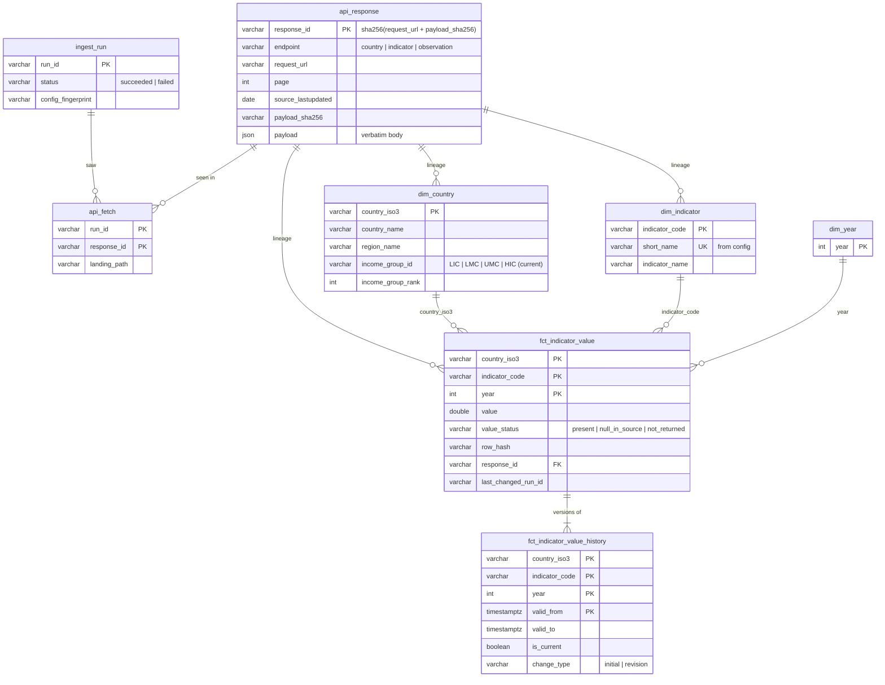

# Data model

The warehouse is a single DuckDB file (`data/warehouse.duckdb`) with one schema per layer.
Data only flows forward: `raw` → `staging` → `core` → `marts`.

| Schema    | Purpose                                                        | Written by        | Load style                     |
|-----------|----------------------------------------------------------------|-------------------|--------------------------------|
| `raw`     | API responses exactly as received, plus run bookkeeping        | `wbpipe ingest`   | append-only, content-deduped   |
| `config`  | The configured countries / indicators / years                  | `wbpipe transform`| replaced each transform        |
| `staging` | Responses of one ingest run, parsed into typed rows            | `wbpipe transform`| replaced each transform        |
| `core`    | Conformed dimensions and the indicator fact (+ its history)    | `wbpipe transform`| dims replaced; fact upserted   |
| `quality` | Data-quality results and diagnostic views                      | `wbpipe check`    | results appended; views        |
| `marts`   | Analyst-facing answers to the reporting questions              | _next step_       | views                          |

## Entity relationships

## Tables

### `raw.ingest_run` — one row per ingest attempt
Business key `run_id` (`<UTC timestamp>-<random>`). Failed runs are recorded with their error
and register nothing else, so downstream layers only ever see complete snapshots.

### `raw.api_response` — one row per distinct API response page
Business key `response_id` = sha256 of the request URL and the payload hash. The same page with
the same content is therefore stored once, however often it is fetched; a changed page gets a
new id. The payload is the response body verbatim; the same bytes are also on disk at
`data/landing/<run_id>/<endpoint>/[<indicator>/]page_NNNN.json`.

### `raw.api_fetch` — which responses each successful run saw
Grain: run × response. This is how a run's complete snapshot is reconstructed even when most of
its responses were first stored by an earlier run.

### `staging.*` — one ingest run, parsed
`current_response` holds the responses of the run being transformed (default: latest successful
run; any older run can be replayed). `stg_country`, `stg_indicator` and `stg_observation` flatten
the JSON into typed, trimmed columns, keeping `response_id` on every row. `stg_observation` also
keeps `value_raw`, so a value that fails to parse is detectable instead of looking missing.
Staging is not deduplicated or scoped; that happens in `core`.

### `core.dim_country` — grain: configured country
Business key `country_iso3`. Built from `config.country` left-joined to the API metadata, so a
configured country is present even if the API did not describe it (attributes NULL, flagged by
data-quality checks). **Income group is the current World Bank classification applied to all
years**: the API exposes no historical classification. It is a type-1 dimension.

### `core.dim_indicator` — grain: configured indicator
Business key `indicator_code`; `short_name` (from config) is the analyst-friendly alias and is
unique too.

### `core.dim_year` — grain: configured year

### `core.fct_indicator_value` — grain: country × indicator × year
Business key `(country_iso3, indicator_code, year)`; each column is a foreign key to its dimension.

- **Complete spine.** Every configured combination has exactly one row, whether or not the API
  returned it. `value_status` says why `value` may be NULL:
  - `present`: the API returned a value.
  - `null_in_source`: the API returned the row with `value: null`.
  - `not_returned`: the API did not return the row at all.

  Missing data is never coerced to 0.
- **Lineage.** `response_id` points to the `raw.api_response` the value was read from, and from
  there to the landing file and request URL. It is NULL only for `not_returned` rows.
- **Idempotent upsert.** `row_hash` covers the business content (value, status, obs_status, unit,
  decimals). A row is written only when its hash changes, so re-running on unchanged data writes
  nothing. If a page changes because of *another* row, the unaffected rows only get their
  `response_id` refreshed. That is a lineage update, not a revision.
- **Scope follows config.** Adding a country, indicator or year adds spine rows on the next
  transform. Removing one deletes its fact rows. Its history is closed, not deleted.

### `core.fct_indicator_value_history` — SCD type 2 of the fact
One row per version of a fact row. `valid_from` / `valid_to` are transform timestamps, and
`valid_from_run_id` / `valid_to_run_id` name the ingest runs. `change_type` is `initial` for the
first version of a key and `revision` afterwards (source corrections, values filled in late,
values withdrawn). A closed version without a successor means the key left the configured scope.

### `core.transform_run` — one row per transform
Which ingest run the core layer was built from (`ingest_run_id`), when, and how many fact versions
were opened or closed. Data-quality checks run against the latest row.

## Data quality

Checks are declared in `config/dq_checks.yaml`. Each one is a SQL query that returns the
violating rows. `wbpipe check` runs all of them after every transform:

- **Severity `fail`** stops the pipeline (exit code 1) before outputs are published. Examples:
  grain or spine violations, broken dimension links, unparseable or out-of-range values, lineage
  that doesn't resolve to the checked ingest run, a configured country the API didn't describe.
- **Severity `warn`** is recorded and reported, and the pipeline continues. Examples: GDP /
  population vs GDP per capita outside tolerance, missing values, out-of-scope rows from the API,
  stale source data, an ingest failure since the checked run.
- A check whose SQL errors gets status `error` and always blocks, because an unknown result is
  not a pass.

Results are appended to `quality.dq_result` (one row per check per execution) and written to
`output/dq_results.csv` and `output/dq_report.md` (with sample violating rows).
`quality.v_gdp_per_capita_consistency` shows the cross-indicator comparison for every
country-year, with its relative difference and status.

Per-indicator plausible ranges (`valid_min` / `valid_max`) and the consistency rule live in
`config/pipeline.yaml`. Quality settings are not part of the scope fingerprint, so tuning a
threshold does not count as a scope change.

## Adding a country or indicator
Edit `config/pipeline.yaml` and run `make run`. No code or SQL changes: the request plan, the
spine and the dimensions are all derived from configuration.
